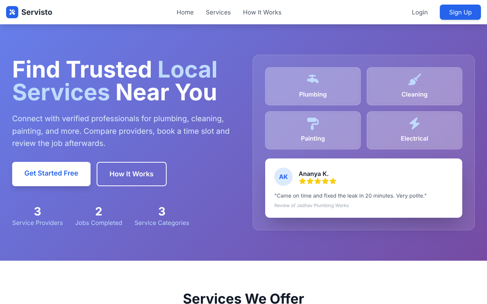
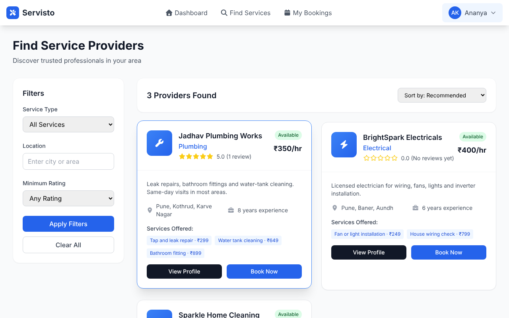
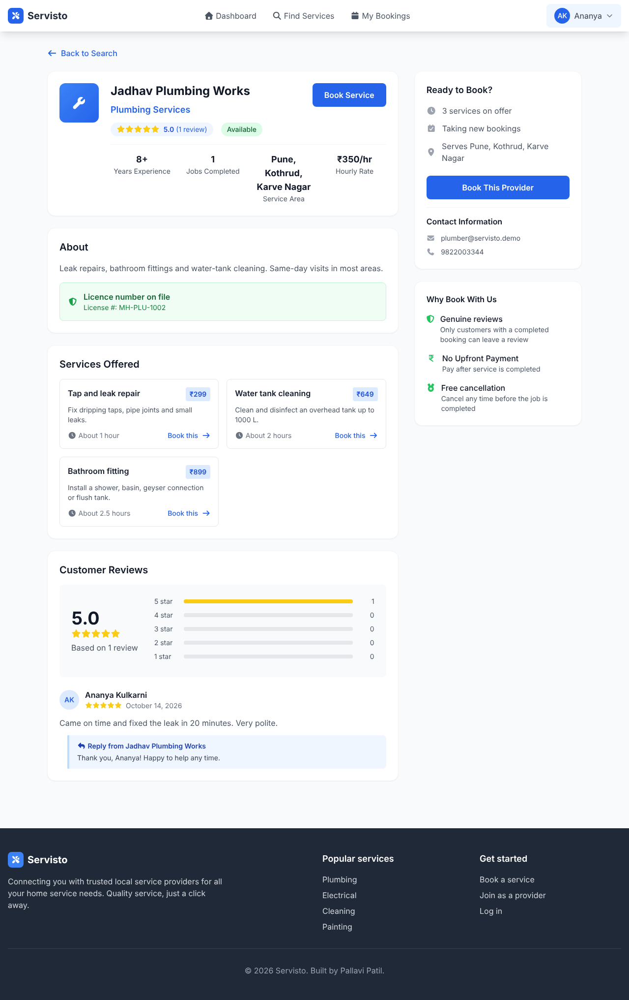
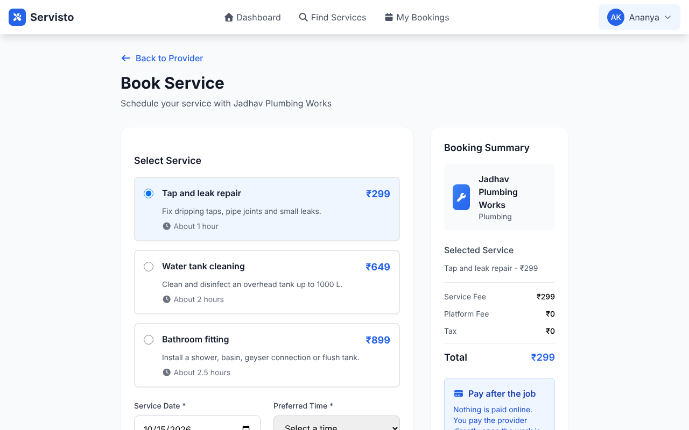
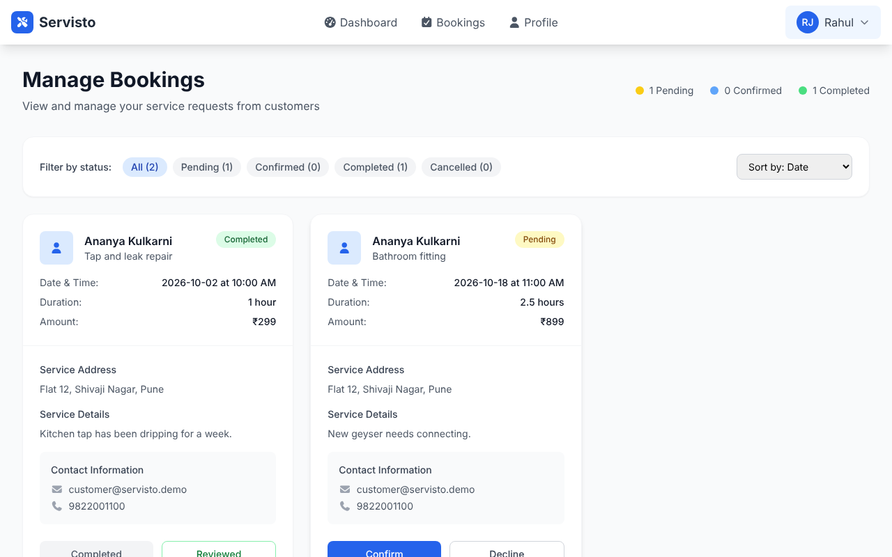
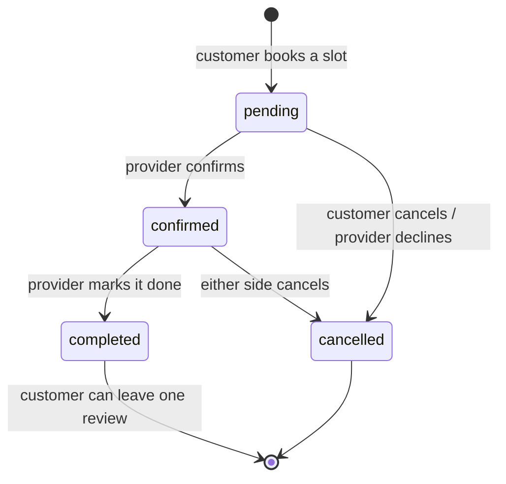

# Servisto

A web app for booking local home-service professionals such as plumbers, electricians and cleaners.

- **Customers** search for providers, compare their services and prices, book a time slot, cancel, and review the job afterwards.
- **Providers** manage their profile and the services they offer, confirm and complete bookings, switch their availability, and reply to reviews.

**Stack:** Python 3, Flask, Flask-Login, SQLite, Jinja2 templates, Tailwind CSS, vanilla JavaScript (`fetch`), Gunicorn, Docker.

**Tests:**
- 55 pytest tests for the server.
- 6 Playwright browser tests that click through the real pages in Chromium.
- GitHub Actions runs them on every push, together with a Docker build and smoke test.



---

## Features

| For customers | For providers |
|---|---|
| Search by service type, area and minimum rating; sort by rating, number of reviews or price | Dashboard with booking counts, this month's earnings and average rating |
| Provider profile with services, prices, reviews and the provider's replies | Edit the business profile: type, area, experience, hourly rate, licence |
| Book a service: pick the service, a date and a free time slot | Add services, and switch each one on or off |
| My bookings, filtered by status, with the provider's contact details | Bookings filtered by status and sorted by date, customer or service |
| Cancel a booking while it is pending or confirmed | Confirm, complete or cancel bookings |
| Rate and review a completed job (1 to 5 stars), once per booking | Reply to reviews; replies appear on the public profile |
| | Set availability: available, busy or unavailable |

Prices are shown in rupees with Indian digit grouping (₹1,25,000).

| Search | Provider profile |
|---|---|
|  |  |

| Booking a slot | Provider bookings |
|---|---|
|  |  |

## How bookings work



The server enforces these rules:
- **Allowed status changes only.** A provider can't jump from pending straight to completed, or reopen a completed job. Breaking a rule gets a 409.
- **No double booking.** A partial unique index on `(provider_id, service_date, service_time) WHERE status IN ('pending', 'confirmed')` means a provider can't have two open bookings in the same slot. This holds even if two customers submit at the same moment. The booking form greys out slots that are already taken, and a cancelled booking frees its slot.
- **The price comes from the database,** not from the form. The chosen service must belong to that provider and still be active.
- **Reviews** are allowed only on the customer's own completed bookings, once each, with a 1–5 rating. The provider's average rating is recalculated after each review.
- **Ownership.** Every booking, service and review query is scoped to the logged-in user, so changing an id in the URL does not give access to someone else's data.

## Security

- **Passwords** are hashed with Werkzeug (scrypt). A wrong email and a wrong password give the same error message.
- **CSRF protection** ([`csrf.py`](csrf.py)):
  - Every session gets a random token.
  - Forms send it in a hidden field, and `fetch` calls send it in an `X-CSRFToken` header, added automatically by [`static/js/script.js`](static/js/script.js).
  - Any POST without the matching token is refused with 400.
  - Logging out and cancelling a booking are POST requests, so a link or image on another site can't trigger them.
- **SQL** always uses parameters. Sort orders are chosen from a fixed list, so request text never becomes part of a query.
- **Redirects:** login only follows `?next=` links that stay on this site.
- **Cookies** are HttpOnly and SameSite=Lax. They are also Secure when `SECURE_COOKIES=true`.
- **Settings** come from environment variables or `.env`, and debug mode is off by default. There are no debug routes and no secrets in the code.

## Running it locally

```bash
python -m venv .venv && source .venv/bin/activate      # Windows: .venv\Scripts\activate
pip install -r requirements.txt
cp .env.example .env                                   # then set SECRET_KEY
python main.py                                         # http://127.0.0.1:5000
```

The database is created in `instance/servisto.db` on first start. Demo accounts are added while it is empty:

| Role | Email | Password |
|---|---|---|
| Customer | customer@servisto.demo | demo1234 |
| Provider (plumbing) | plumber@servisto.demo | demo1234 |
| Provider (electrical) | electrician@servisto.demo | demo1234 |
| Provider (cleaning) | cleaner@servisto.demo | demo1234 |

Set `SEED_DEMO_DATA=false` to start with an empty site.

**With Docker:**

```bash
docker build -t servisto .
docker run -p 8000:8000 -e SECRET_KEY=change-me -v servisto-data:/data servisto   # http://localhost:8000
```

**On Render (free plan):** create a *Blueprint* from this repository. [`render.yaml`](render.yaml) sets the build and start commands, the health check and a generated `SECRET_KEY`. The free plan has no persistent disk, so the demo data is recreated after each restart.

## Configuration

| Variable | Default | Purpose |
|---|---|---|
| `SECRET_KEY` | random per run | Signs session cookies. Set it in production |
| `DATABASE_PATH` | `instance/servisto.db` | SQLite file |
| `SEED_DEMO_DATA` | `true` | Add demo accounts and bookings when the database is empty |
| `SECURE_COOKIES` | `false` | Send cookies over HTTPS only |
| `FLASK_DEBUG` | `false` | Debug mode, for local use only |
| `PORT` | `5000` (`8000` in Docker) | Port to listen on |

## Tests

```bash
pip install -r requirements-dev.txt
pytest --ignore=tests/e2e                     # 55 server tests, about 20 seconds
python -m playwright install chromium
pytest tests/e2e                              # 6 browser tests
```

| File | What is covered |
|---|---|
| `test_auth.py` | Registration for both roles, validation, login, safe `next` redirects, POST-only logout, role separation, home page figures |
| `test_customer.py` | Search filters and sorting, provider profile, booking and every booking validation rule, double-booking prevention, cancelling, reviews, other customers' bookings |
| `test_provider.py` | Profile and service validation, service on/off, the booking state machine, other providers' data, sorting, replies to reviews, availability |
| `test_security.py` | CSRF for forms and `fetch`, every POST form carries a token, HTML escaping, cookie flags, settings from the environment, no debug routes, rupee formatting |
| `e2e/test_browser.py` | In Chromium: find and book a provider (slot greyed out afterwards); provider confirms and completes, customer reviews, provider replies; cancel; a new provider sets up and appears in search; availability; phone-width layout and menu |

CI ([`.github/workflows/ci.yml`](.github/workflows/ci.yml)) runs:
- the server tests on Python 3.11, 3.12 and 3.13
- the browser tests
- a check that the committed Tailwind CSS matches the templates
- a Docker build, which is then started and used: home page, CSRF-protected login, bookings page

## Project layout

```
main.py              app factory, settings, login manager, filters, error pages
auth.py              register / login / logout
user_routes.py       customer pages
provider_routes.py   provider pages and JSON endpoints
database.py          SQLite schema, connections, date handling
csrf.py              CSRF tokens
seed.py              demo data
templates/           Jinja2 pages
static/              Tailwind build, Font Awesome (served locally), JavaScript
tests/               pytest and Playwright tests
```

The CSS is pre-built, so running the app needs no Node.js. After adding Tailwind classes to a template, rebuild it with `npx tailwindcss@3.4.17 -i assets/tailwind.css -o static/css/tailwind.css --minify` (or `npm run build:css`).
